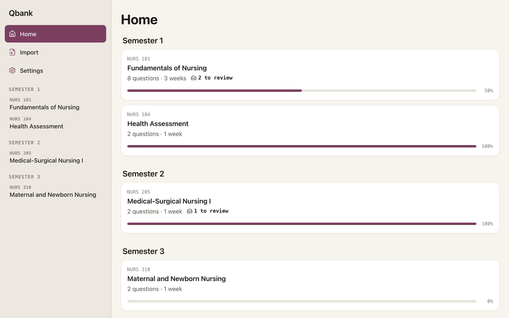
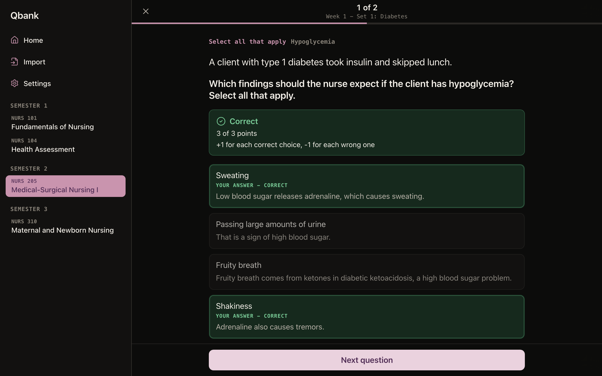
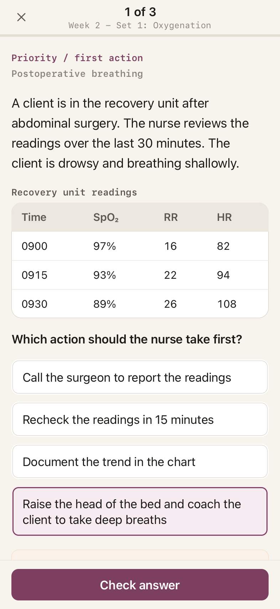
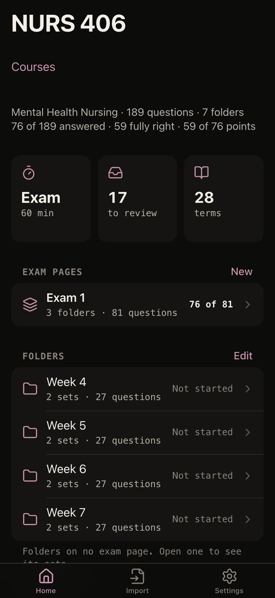
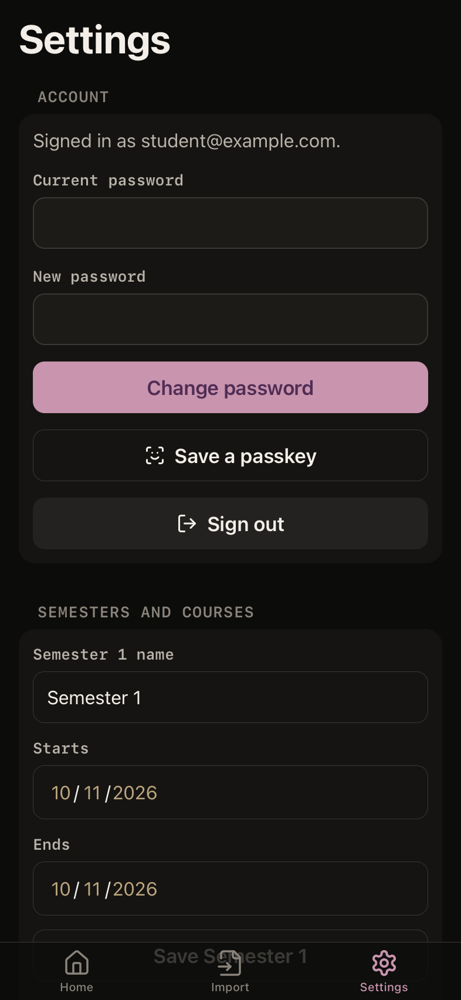

# Qbank

Qbank is a small web app for practicing NCLEX-style questions (the NCLEX is
the exam nurses pass to get their license). It was made for one nursing
student in an accelerated BSN program, and keeps her questions and answers in
sync across her iPhone, iPad, and Mac.

- **Practice sets in folders.** She imports a question file into a folder of
  its course (Unsorted unless she picks one), and arranges the folders herself:
  rename them, move sets between them, put them in her own order, and gather
  the ones an exam covers on an exam page (Exam 1 over Weeks 1-3), with the
  exams she took over them. Courses, topics, exam pages, sets, folders, and past
  exams can be deleted after a warning naming everything that goes (an exam
  page goes alone, and its folders stay), and Undo brings them back for 30
  days.
- **Eight NCLEX question formats.** Single answer, priority, select all that
  apply, highlight, ordering, matching, matrix, and drop-down, scored with
  partial credit. Every option explains why it is right or wrong.
- **Timed exams** drawn from the folders she picks, in proportion to each
  folder. A folder can have its own exam-only question bank, and an exam can be
  limited to the questions she got wrong.
- **Review** keeps every practice question she missed or marked "I'm guessing"
  until she gets it right; exam questions she gets wrong come back in a
  wrong-questions exam instead. **Terms** lists each course's definitions.
- **Installable.** Added to the Home Screen or the Dock, it opens full screen,
  with an iPhone layout and an iPad and Mac layout, in light or dark.
- **Private.** Only emails the owner approves can sign up. The owner has an
  admin account to import files and fix things, and sees her progress
  read-only. Delete account in Settings removes her user account and
  everything in it for good.

<p align="center">
  
  
</p>
<p align="center">
  
  
  
</p>
<p align="center"><sub>A local copy with invented sample questions.</sub></p>

For study use only; not clinical advice.

## How it is built

| Piece | What it uses |
|---|---|
| Screens (this repository) | React and TypeScript with Vite, an installable web app (PWA), served by Caddy from the web image; types generated from the API's contract |
| API ([D-E-A-G/qbank-server](https://github.com/D-E-A-G/qbank-server)) | Hono and TypeScript on Node, zod on every request, an OpenAPI description generated from the routes, and the question formats, scoring, exam planning, and import checks |
| Database | Postgres 16 through Drizzle, used by the API |
| Sign-in | Better Auth: email and password, saved and filled in by the browser or the iPhone |
| Tests | Vitest, and Playwright on iPhone and desktop browsers against the web image and the API image |
| Hosting | One DigitalOcean server declared in OpenTofu, running Caddy, the screens, the API, and Postgres in Docker Compose; nightly database backups to Cloudflare R2 |
| CI and deploys | GitHub Actions: every change is linted, type-checked, tested, built, run end to end, and checked for secrets; merging to `main` deploys the new web image over Tailscale |

Every rule lives behind the API, not in the screens, so a native iOS app could
use the same API, accounts, and data. The full product spec, with every
screen, rule, and decision, is in [`docs/product-spec.md`](docs/product-spec.md).
The server's setup, from OpenTofu to backups, is in the private
[D-E-A-G/deag-infra](https://github.com/D-E-A-G/deag-infra) repository. This
repository builds the web image (the built screens, served by Caddy, which
the server sends every request to that is not for the API) and asks the server
to deploy it; everything that deploy needs to know about the server is in
Actions secrets. The API is built and deployed from the private
[D-E-A-G/qbank-server](https://github.com/D-E-A-G/qbank-server) repository.

## The API

The screens are one client of the API, and use nothing else. The API lives in
the private [D-E-A-G/qbank-server](https://github.com/D-E-A-G/qbank-server)
repository, which builds and deploys it and holds every rule: scoring, Review,
exams, and imports. On the server, Caddy sends `/api`, `/api/*`, `/health`, and
`/openapi.json` to the API and everything else to the web image, on the same
hostname.

The API describes itself at `/openapi.json`. A copy is pinned in
[`apps/web/contract/openapi.json`](apps/web/contract/openapi.json), and
[`pin.json`](apps/web/contract/pin.json) beside it names the qbank-server commit
it came from and the API image built from that commit.

- `pnpm openapi` generates the screens' types, `apps/web/src/api-schema.ts`,
  from the pinned copy with openapi-typescript. A test fails when the two
  differ.
- The end-to-end tests run against that API image, and `/health` must name
  the pinned commit. Before they run, CI also checks that the image serves the
  pinned copy.
- The Contract workflow compares the pinned copy with the live `/openapi.json`
  every day, and fails once the live API serves a different one.

To pin a newer API, pick a commit on qbank-server's `main` whose image was
published: the Deploy job of its CI run shows
`IMAGE: ghcr.io/d-e-e-g/nclex-qbank-api@sha256:...`. Then:

```sh
commit=<the qbank-server commit>
gh api "repos/D-e-e-g/qbank-server/contents/apps/api/openapi.json?ref=$commit" \
  -H "Accept: application/vnd.github.raw" >apps/web/contract/openapi.json
# Put the commit and the image in apps/web/contract/pin.json, then:
pnpm openapi
pnpm typecheck   # shows what the new contract changes for the screens
```

## Run it locally

You need Node 24 (see `.node-version`), pnpm (through Corepack), and the API.
Run the API from a qbank-server checkout, as its README describes, on port 8080
with `BETTER_AUTH_URL=http://localhost:8080` and `SEED_ACCOUNTS=1`. Then:

```sh
corepack enable
pnpm install
pnpm dev
```

Open <http://localhost:5173>. Vite sends `/api`, `/health`, and
`/openapi.json` to the API on port 8080 and reloads the screens on every
change. Sign in with a sample account: `student@example.com` /
`student-pass-1`, or the admin, `owner@example.com` / `admin-pass-1`. Import a
question file from Import; the format is under
[The import file](docs/product-spec.md#the-import-file) in the spec.

To run the site the way the server does, `e2e/stack.sh up` builds the web
image and starts it with the pinned API image, Postgres, and Caddy in front, at
<http://localhost:4318>. It needs Docker, and `docker login ghcr.io` with read
access to the `nclex-qbank-api` package. `e2e/stack.sh down` stops it and drops
the database.

Checks, as CI runs them:

```sh
pnpm lint
pnpm typecheck
pnpm test        # includes the contract test
pnpm build
pnpm exec playwright install chromium webkit   # once
e2e/stack.sh up  # the end-to-end tests start from an empty database
pnpm test:e2e
e2e/stack.sh down
```

## Who made it

Qbank was built by Dimitry Gallego.

Copyright (c) 2026 Dimitry Gallego. All rights reserved.
